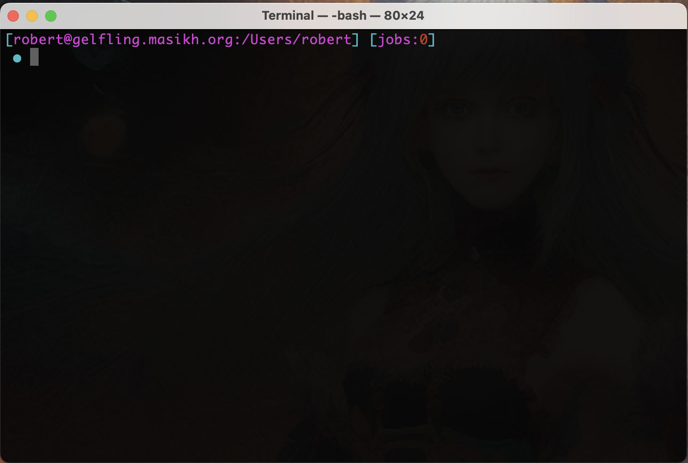
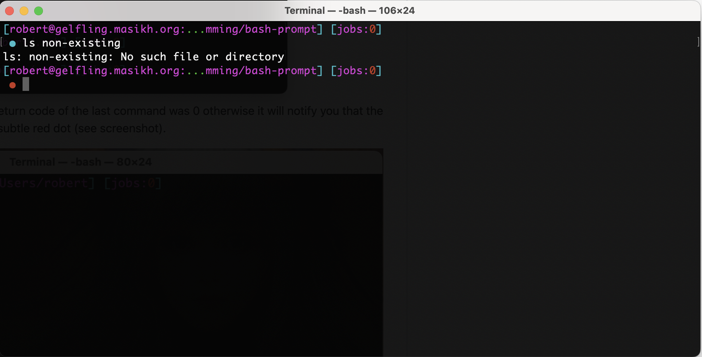
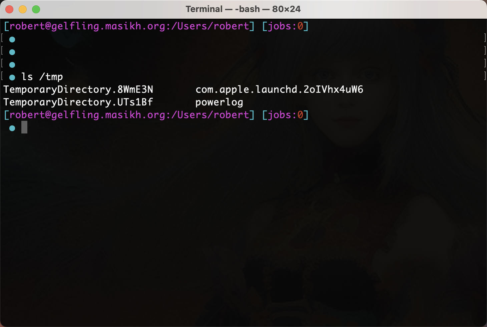
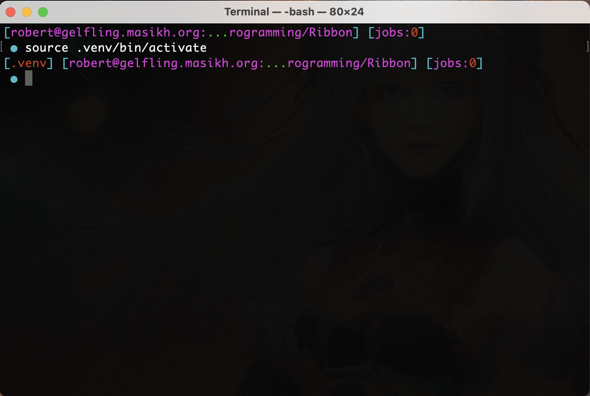
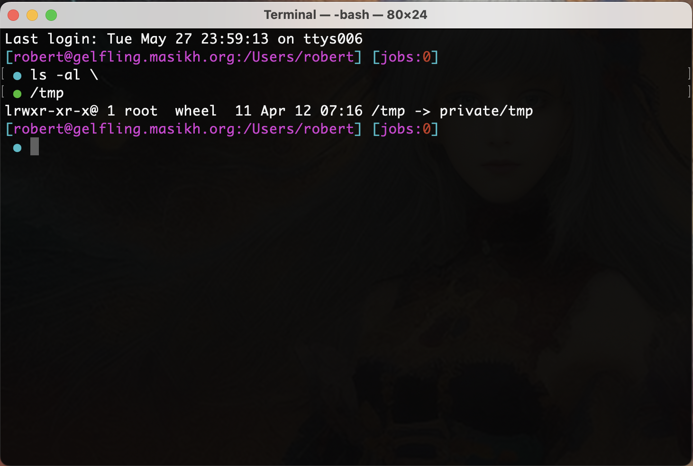
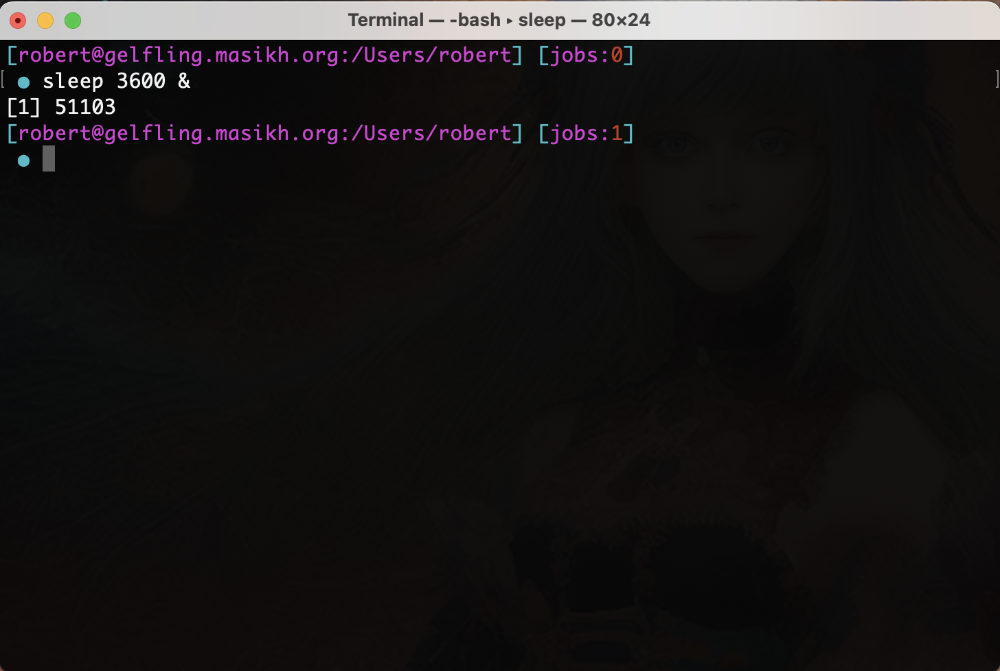

# Prompt

   

.zshrc is for the zsh shell
.bash_profile is for the bash shell

An shell environment file that shows:

- username and hostname
- your path (truncated) 
- number of jobs running in this shell
- integrate venv python prompt (if python venv is sourced)
- repeated dots when no new command yielding a history entry is given
- multi-line commands get a green dot
 

The shell prompt has a blueish dot if the return code of the last command was 0 otherwise it will notify you that the last command existed erroneously with a subtle red dot (see screenshot).

